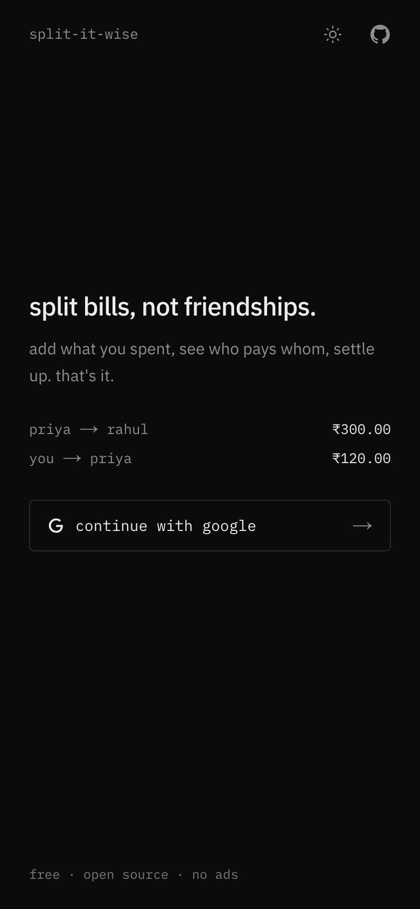
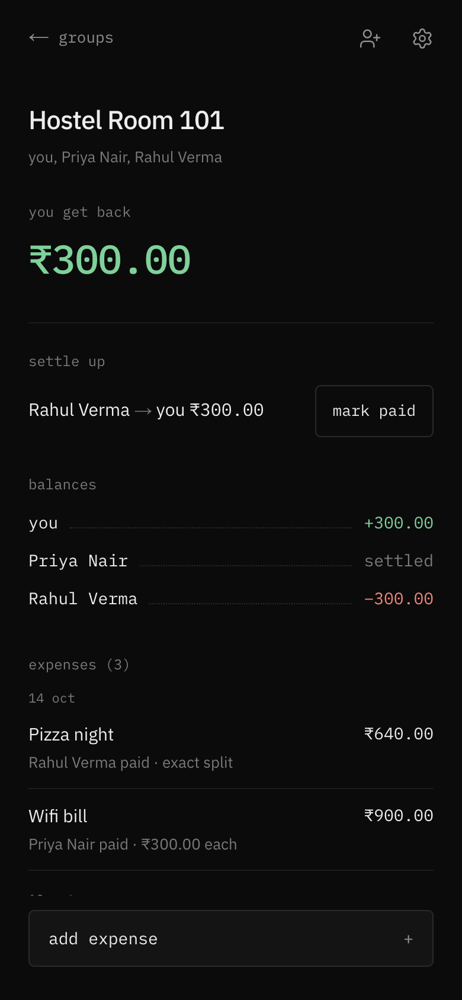

# Split-It-Wise

**Split bills, not friendships.** Add what you spent, see who pays whom, settle up.

Built for hostel rooms, road trips and chai runs. Free, no ads, no trackers.

[**Open the app →**](https://split-it-wise.vercel.app)
&nbsp;·&nbsp; [Report a bug](https://github.com/aashu2006/split-it-wise/issues/new?template=bug_report.yml)
&nbsp;·&nbsp; [Request a feature](https://github.com/aashu2006/split-it-wise/issues/new?template=feature_request.yml)
&nbsp;·&nbsp; [Contribute](CONTRIBUTING.md)

 

<table>
  <tr>
    <td></td>
    <td></td>
  </tr>
</table>

## Features

**Groups**
- Create a group and invite friends with a link that works well over WhatsApp
- Turn the invite link off once everyone's in, so a forwarded link stops working
- Admins can rename the group, remove members and delete it

**Expenses**
- Split equally, by exact amounts, or by percentage
- Edit or delete an expense; everyone's balances update instantly
- Changes appear live on every phone in the group, no refresh needed
- Dark by default, with a light mode a tap away

**Settling up**
- Balances are simplified into the fewest payments: *"Rahul pays Akshat ₹300"*
- Pay however you usually do, then mark it paid; part payments and undo included

## Getting it right with money

- **No rounding drift.** All maths runs in whole paise, so ₹100 split three ways is
  ₹33.34 + ₹33.33 + ₹33.33, and a group's balances always sum to exactly zero.
- **Fewest transfers.** A group of *n* people never needs more than *n − 1* payments
  to settle completely.
- **Nobody disappears from the ledger.** Someone who leaves with money still to pay or
  get back stays visible, tagged *left group*, until they're settled.
- **Repayments aren't spending.** Paying a friend back never inflates the group's
  spending totals.

## Privacy and security

- **Every permission is enforced on the server** by [Firestore security rules](firestore.rules):
  only members can see a group's expenses, and only the right people can change them.
  The rules have their own [test suite](tests/rules) that runs on every pull request.
- **Your email stays private.** Other members see only your name and photo. Your email
  is never stored where they can read it.
- **Private pages stay out of search engines.** Group and invite pages are never indexed.
- **No ads, no analytics, no trackers.**

Found a vulnerability? Please report it privately; see [SECURITY.md](SECURITY.md).

## Built with

| | |
|---|---|
| Framework | [Next.js 16](https://nextjs.org) (App Router), React 19 |
| UI | Tailwind CSS v4, shadcn/ui |
| Auth & data | Firebase Authentication (Google), Cloud Firestore |
| Testing | Vitest, Playwright end-to-end, Firebase emulator for the security rules |
| Hosting | Vercel |

## Contributing

Contributions are welcome, from bug reports and ideas to code. Start with
[CONTRIBUTING.md](CONTRIBUTING.md): it covers the branch workflow, running the app in
demo mode without any setup, and the checks every pull request needs to pass.
Please also read the [Code of Conduct](CODE_OF_CONDUCT.md).

Looking for something to work on? Check the
[open issues](https://github.com/aashu2006/split-it-wise/issues).

> **Using Split-It-Wise?** Just open [split-it-wise.vercel.app](https://split-it-wise.vercel.app).
> This repository is for developing the app. Running it locally is for contributors
> working on a change; it isn't a supported way to host your own copy.

## License

[MIT](LICENSE) © Akshat Patil and contributors.

The name *Split-It-Wise* and its logo identify this project. If you publish a fork,
please give it a different name and logo so people don't mistake it for this app.
